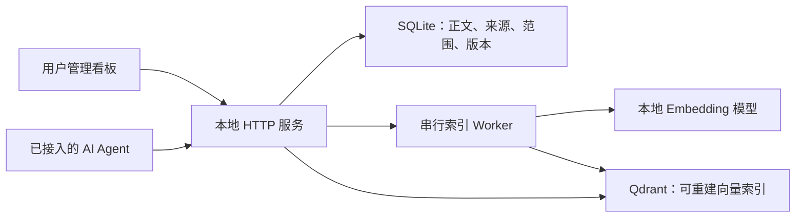

# SharedMemoryHub · 多 Agent 个人记忆档案与协作工作台

A self-hosted personal memory archive and review workbench for AI agents.

让不同 AI 助手按需复用你已整理的背景、偏好、项目决定和经验，同时让你能够分类浏览、纠正和追溯这些记忆。

**基础版本 · 持续共建中。** 已有正文存储、记忆管理看板、检索和 AI 草稿协作的基础实现。Codex、Antigravity 已有 HTTP / CLI 接入入口；Claude 等客户端适配欢迎共建。各端真实会话、全新环境部署和检索质量仍需分别验证，详见[验证范围](docs/VERIFICATION.md)。

[开始体验](#开始体验) · [客户端适配](#客户端适配) · [使用说明](docs/使用与系统说明.md) · [参与共建](CONTRIBUTING.md) · [改进路线](docs/ROADMAP.md)

## 它解决什么问题

- **反复介绍自己：** 使用不同助手时，可以从同一份有来源和适用范围的记忆中取用背景。
- **记错了不容易改：** 用户可以按分类点击浏览，查看正文、来源和版本，编辑、暂停、锁定或删除条目。
- **同一个事实有多个旧副本：** 可以预览相关条目的整理建议，确认后整组应用，并保留历史。
- **有想法却不想填表：** 先写原话，让 AI 澄清并整理，再由自己决定是否采纳。

主要面向使用一种或多种 AI Agent 的个人用户，以及希望改进记忆管理与客户端接入的开发者。GitHub 保存程序和协作记录；每个部署者自行保存记忆数据与认证。

## 一条记忆怎样被使用

以虚构偏好“项目交接请先列未解决问题”为例：

1. 直接记一条，或把原话保存为草稿。
2. 授权一个已接入的 AI 读取该草稿，协助补齐正文和适用范围。
3. 在看板中比较建议、确认准确性并采纳；需要范围批准的候选继续等待批准。
4. Agent 在相关任务中查找候选，再按权限读取正文。
5. 偏好发生变化时，用户可以纠正并查看历史；后续读取以当前状态和修订为准。

草稿不会直接进入普通记忆检索。保存正文、批准适用范围和向量索引完成是不同状态。

## 当前基础能力

| 能力 | 当前状态 |
|---|---|
| 分类点击浏览、宽幅详情、正文与属性编辑 | 已实现，有合成测试记录 |
| 来源、版本、锁定、暂停、软删除与恢复 | 已实现；锁定保护 AI 修改，暂停退出普通召回 |
| 原话草稿、AI 建议、人工比较与采纳 | 已实现；客户端不能代替管理员批准 |
| 多条关联整理、整组应用与撤销 | 已实现，有事务及合成测试记录 |
| 完全重复复用、疑似重复提醒与保留两条 | 已实现；相似度不直接决定合并 |
| 字面查找、向量候选及权威正文回查 | 已实现；完整中文词法和排名融合待完善 |
| Codex / Antigravity HTTP 与 CLI 入口 | 已实现，真实原生会话及联合接入仍待补验 |
| Claude 适配、MCP、跨平台一键安装 | 待共建，当前不作支持承诺 |

当前服务版本 **0.6.0**、看板 **0.7.0**、Schema **600**。源码中的实现、合成验证、真实客户端验证分别记录；版本号不代表全部场景已经通过。

## 开始体验

当前锁定安装环境为 **Windows x64 / Python 3.13 / PowerShell**。可以在你选择的普通本地目录克隆；项目不要求特定盘符或用户名。Linux、macOS 和其他依赖组合的完整安装尚待验证。

```powershell
git clone https://github.com/woshinibabawangzhe/SharedMemoryHub.git
Set-Location -LiteralPath '.\SharedMemoryHub'

# 会创建项目内虚拟环境并下载锁定依赖；含 CUDA 版 PyTorch，下载体积较大。
py -3.13 -B scripts/portable_setup.py install

# 开发者合成演示：无需下载模型或启动 Docker。
& '.\.venv-0.3.0\Scripts\python.exe' -X utf8 -B scripts/demo.py
```

终端输出预览地址，在浏览器打开该地址加 `/ui`。公开合成口令为 **`Synthetic-browser-070`**，只适用于演示。按 `Ctrl+C` 停止；再次运行会创建新的合成实例。

演示只用虚构内容、模拟 Embedding 和向量组件，不证明真实语义检索质量。它不读取其他 Agent 的个人文件，也不配置 Agent 的规则。当前安装器仍较重，轻量演示环境是[共建任务](docs/ROADMAP.md)之一。

真实模型、Docker Qdrant、初始化与恢复见[部署和运行目录说明](docs/部署与运行目录.md)。不要把合成演示口令用于真实实例。

## 客户端适配

记忆中心承担正文、权限、版本和检索；客户端适配负责身份、工作区、会话来源及调用时机。使用者不需要复制特定个人的 Harness 配置。

| 客户端 | 现有入口 | 验证与共建状态 |
|---|---|---|
| Codex 编码助手 | `--client codex`；草稿使用真实 `CODEX_THREAD_ID` | 有契约测试；需独立原生会话验证 |
| Antigravity 开发助手 | `--client antigravity`；草稿传真实宿主会话标识 | 有契约测试；需原生与联合验证 |
| Claude 系列 Agent | 尚无专用身份与接入适配 | 先选定具体宿主，例如 Claude Code，再提交适配与证据 |
| 其他 Agent | 参考共同 HTTP 契约扩展 | 需同步认证、权限、来源及测试，不能冒用已有客户端身份 |

当前通过 HTTP API 和 Python CLI 接入，尚未提供 MCP。认证仍显式识别前两种客户端；“面向多 Agent”是产品方向，不代表任意客户端已经兼容。

实际步骤见 [AI 客户端接入指南](docs/AI客户端接入指南.md)，字段和异常见[客户端调用规范](docs/客户端调用规范.md)。服务不可用时，客户端应继续主任务并说明记忆不可用；接入不应自动启动服务或改写用户原有规则。

## 系统怎样工作



**聊天主模型整理文字；本地 Qwen3-Embedding-0.6B 把文字转为向量。** SQLite 保存可读正文和权威状态，Qdrant 提供相关候选。看板展示正文数据库中的内容；草稿、权限、版本和删除状态不由向量决定。

项目起点来自对 [Mem0](https://github.com/mem0ai/mem0) 的研究。当前实现以本仓库源码为准，现有服务并非直接封装 Mem0；具体能力与上游项目分别判断。

## 参与共建

欢迎提交使用反馈、可复现的问题和聚焦的 Pull Request。优先任务包括：

- **客户端适配：** Claude 等第三客户端，以及 Codex、Antigravity 的原生会话验证。
- **部署体验：** 新环境安装、轻量合成演示、CPU 路径与跨平台验证。
- **记忆质量：** 中文检索、无答案误召回、去重和关联整理。
- **管理体验：** 分类浏览、键盘操作、200% 缩放和未保存保护。
- **可靠性：** 并发修改、幂等、清除补偿与备份恢复。

[改进路线](docs/ROADMAP.md)列出每项的范围与验收要求。提问或报告问题请使用 [Issues](https://github.com/woshinibabawangzhe/SharedMemoryHub/issues)，贡献前阅读[协作指南](CONTRIBUTING.md)。复现仅使用合成或已脱敏资料。

## 文档与源码

- [使用者：看板和系统说明](docs/使用与系统说明.md)
- [部署者：安装、目录和真实后端](docs/部署与运行目录.md)
- [适配开发者：客户端接入](docs/AI客户端接入指南.md)
- [贡献者：开发与验证](CONTRIBUTING.md)
- [完整文档导航与历史设计](docs/项目文档导航.md)

```text
hub/       HTTP 服务、SQLite、权限、索引 Worker 和看板
clients/   记忆与草稿 CLI
scripts/   演示、环境、启动、迁移和恢复入口
tests/     确定性测试、合成夹具与可选集成检查
docs/      使用、部署、接入、验证和共建说明
design/    已归档的设计沿革，不能替代当前实现契约
```

## 数据与许可

真实记忆、来源原文、认证、备份、模型和运行日志不进入源码仓库。记忆不能替代行为规则或扩大执行权限。备份和恢复需保留最新清除记录。

**许可证尚待确定，当前未附 `LICENSE`。** 欢迎讨论和审阅；贡献、复用及分发安排需先与项目维护者确认。上游依赖和模型遵守各自许可。
