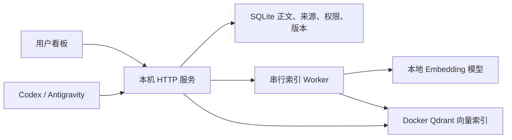

# SharedMemoryHub · 个人记忆档案与多 AI 协作工作台

Local-first memory archive and review workbench for Codex and Antigravity.

**状态：实验性源码候选，欢迎使用合成数据协作改进。** 当前源码为服务 **0.6.0**、看板 **0.7.0**、Schema **600**；这不代表维护者的日常实例已完成升级，也不代表原生双端联调已通过。更新于 2026-11-11。

这个项目希望解决：换一个 AI 后仍能复用已确认的背景与偏好；记忆可以由人查找、纠正、批准、暂停和追溯；同一事实更新时，能一次预览相关条目的变化。

## 系统存放什么

- **正式记忆：** 有主体、适用范围、来源、确认状态和版本的可读条目，例如已确认偏好、项目决定、已验证经验和有期限的交接。
- **草稿与建议：** 先保存用户原话，由 AI 帮助澄清和整理，再由人确认。草稿不会直接进入普通召回或向量索引。
- **索引：** 支持含义召回的可重建向量；正文、权限、版本和删除状态以 SQLite 为准。

行为规则、完整聊天、API 密钥和登录态不作为普通记忆导入。公开仓库只保存源码、合成夹具和说明；个人记忆与认证各自在本机管理。

## 架构与模型分工



**聊天主模型整理文字，本地 Qwen3-Embedding-0.6B 把文字转换为向量。** 0.6B 模型不负责判断事实、授予权限或批准记忆。看板展示的是 SQLite 中的可读正文和状态。

项目起点来自对 [Mem0](https://github.com/mem0ai/mem0) 的研究。当前仓库中的服务实现、依赖和数据模型以 `hub/` 为准；这里没有把上游的全部能力当作本项目已实现能力。

## 当前能力与边界

| 功能 | 当前情况 |
|---|---|
| 分类点击浏览、宽幅详情、正文与元数据编辑 | 已实现，有合成浏览器验证 |
| 来源、历史版本、锁定、暂停、软删除与恢复 | 已实现；锁定保护 AI 修改，暂停退出普通召回 |
| 原话草稿、授权 AI 整理、人工比较与采纳 | 已实现；管理员与客户端权限分离 |
| 多条关联整理、整组应用与撤销 | 已实现，有事务和合成浏览器验证 |
| 完全重复复用、疑似重复提醒与保留两条 | 已实现；相似度不直接决定合并，无常驻全库扫描 |
| 字面查找与向量候选回查 | 已实现；完整中文词法和排名融合尚未交付 |
| Codex / Antigravity 共用 HTTP 与 CLI | 已有接口与合成契约测试；原生两端联合验收未完成 |
| MCP、跨平台一键安装、后台自动修改全部关联记忆 | 尚未提供 |

源码候选回归记录：Python **178 项通过、1 项跳过**，前端 Node **6 项通过**。跳过项依赖已停用的维护者旧 Codex 适配入口。最终合成浏览器链路覆盖建议编辑、预览失效、应用和整组撤销；**原生 200% 缩放与未保存原生确认框的两分支仍待补验**。详见[验证范围](docs/VERIFICATION.md)。

新源码启动不会替旧库自动迁移。已有实例应先备份数据库与最新清除记录，再显式迁移；不要用源码公开替代部署或验收。

## 先运行合成演示

当前适配环境是 **Windows x64 / Python 3.13 / PowerShell**。项目路径门禁在 Windows 要求运行资产位于 `E:\AI运行区\`；推荐克隆到 `E:\AI运行区\SharedMemoryHub`。其他盘符、Linux 与 macOS 的完整部署尚未验证。历史脚本中仍有维护者环境路径，需要按文档核对，不能直接照搬。

```powershell
git clone https://github.com/woshinibabawangzhe/SharedMemoryHub.git E:\AI运行区\SharedMemoryHub
Set-Location -LiteralPath 'E:\AI运行区\SharedMemoryHub'

# 首次安装：会下载锁定依赖，CUDA 版 PyTorch 占用较大空间。
# 合成演示不需要下载模型，也不需要启动 Qdrant。
py -3.13 -B scripts/portable_setup.py install

$python = '.\.venv-0.3.0\Scripts\python.exe'
New-Item -ItemType Directory -Force 'receipts\related-070-20261110-120143' | Out-Null
& $python -X utf8 -B tests/related_browser_070.py
```

终端会输出系统分配的 `origin`，在浏览器打开该地址加 `/ui`。演示口令是公开合成夹具 **`Synthetic-browser-070`**，只用于此演示。它使用独立数据库和向量夹具，不加载真实记忆，不代表 CUDA / Qdrant 已完成验收。终端按 `Ctrl+C` 停止。

依赖安装与运行只在你自己的环境进行。不要公开监听服务端口，不要把演示口令用到真实实例；本轮源码发布不会启动维护者的服务或安装依赖。

## 怎样接入 Codex 和 Antigravity

详细步骤、准确参数及边界见 [AI 客户端接入指南](docs/AI客户端接入指南.md) 和 [客户端契约](docs/客户端调用规范.md)。

1. 服务端初始化本机认证、登记项目工作区；需要真实语义检索时准备锁定模型和 Docker Qdrant。
2. 各客户端明确身份、实例、工作区及真实会话来源。令牌由 CLI 内部加载，不粘贴到聊天或命令参数。
3. 在各自 Harness 中由维护者添加简短的按需触发，调用共用 CLI；仓库不会自动改写 `.codex` 或 `.gemini`。
4. 先用合成内容验证召回、来源、锁定、范围审批和离线行为，再决定是否启用真实资料。

| 接入点 | Codex | Antigravity |
|---|---|---|
| CLI 身份 | `--client codex` | `--client antigravity` |
| 草稿建议会话 | 宿主真实 `CODEX_THREAD_ID`，缺失即停止 | `--session-id` 传入真实宿主会话，缺失即停止 |
| 工作区 | 显式传入当前已登记目录 | 显式传入当前已登记目录 |
| 人工批准 | 只能由看板管理员进行 | 只能由看板管理员进行 |

记忆不能变成额外授权。全局候选与规则候选仍需审批；服务不可用时继续主任务，不能虚报保存成功或擅自启动中心。当前维护者的 Harness 自动调用仍暂停。

## 欢迎一起优化与试错

优先协作方向：

- 改进中文分类浏览、200% 缩放、键盘操作与未保存保护。
- 用冻结查询集和独立保留集评估中文检索，报告误召回与延迟。
- 以合成材料完成 Codex 与 Antigravity 的真实会话接入，并分别报告证据。
- 去除维护者绝对路径依赖，改进首次初始化、CPU 路径和可移植部署。
- 增强并发、清除恢复、关联整理和重复治理的故障测试。

请通过 [Issues](https://github.com/woshinibabawangzhe/SharedMemoryHub/issues) 提交脱敏复现，或提交 Pull Request。先读 [协作指南](CONTRIBUTING.md)；一次只处理一个可复核问题。没有提供真实个人数据库或认证用于复现，也请不要上传自己的此类资料。

## 目录

```text
hub/          HTTP 服务、SQLite、权限、索引 Worker 和看板
clients/      共用记忆 CLI 与草稿 CLI
scripts/      环境、启动、迁移、恢复和合成验证入口
tests/       确定性测试与合成夹具
docs/        使用说明、接入契约和验证边界
design/      已纳管的历史设计，不代表全部已实现
```

[使用与系统说明](docs/使用与系统说明.md) · [文档导航](docs/项目文档导航.md) · [换机与恢复参考](docs/换机部署与数据恢复-v0.1.0.md)

## 数据与许可

SQLite、墓碑、原文、备份、认证、模型、缓存与运行证据均不随源码发布。数据恢复必须携带最新墓碑，不应从源码仓库恢复个人记忆。

**许可证尚未确定，目前未附 `LICENSE`。** 源码公开用于讨论、审阅和协作；复用、分发或贡献的许可安排请先向维护者确认。本仓库不替上游依赖或模型授予许可。
